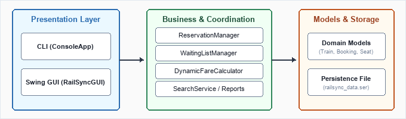

# RailSync — Railway Reservation Management System

**A Java desktop application for searching trains, managing reservations, and demonstrating safe concurrent seat allocation.**

[](https://www.java.com/) [](https://openjfx.io/) [](https://www.sqlite.org/) [](#license)

## Overview

RailSync is an educational railway reservation management system built with **Java, JavaFX, JDBC, and SQLite**. It offers a graphical interface for passengers and administrators, backed by a local database. The project brings together core Java concepts such as object-oriented programming, inheritance, polymorphism, exception handling, collections, generics, event handling, and multithreading.

RailSync uses **illustrative railway data** and is not connected to live railway reservation systems or payment gateways.

## Features

### Passenger features
- Sign in to a passenger account and access a dedicated dashboard.
- Search available trains and view search results.
- Book tickets using the reservation workflow and seat-allocation logic.
- View booking history and ticket information.
- Cancel a reservation using its PNR.
- Handle reservation statuses including confirmed, RAC, and waiting-list cases.

### Administrator features
- Access an administrator dashboard with booking and train metrics.
- Manage train information.
- Inspect waiting-list information.
- Generate and view reports and booking analytics.

### Technical highlights
- **JavaFX GUI:** Desktop screens, forms, tables, menus, and button/mouse event handlers.
- **JDBC + SQLite:** Persistent local storage with repository classes and SQL operations.
- **Concurrent bookings:** Multithreaded simulation and transaction-aware seat allocation to demonstrate contention for limited seats.
- **OOP design:** Train subclasses, user roles, service classes, interfaces, and custom exceptions.
- **Collections and generics:** Reusable repository abstractions and demonstrations of Java collection APIs.
- **AWT demonstrations:** Separate examples of button and window event handling.
- **Testing:** A built-in suite of 17 automated tests using temporary databases.

## Technology stack

| Layer | Technology |
| --- | --- |
| Language | Java 17+ |
| Desktop interface | JavaFX |
| Event handling | JavaFX events and Java AWT demos |
| Database | SQLite |
| Database access | JDBC, SQLite JDBC driver |
| Concurrency | Java threads, synchronization, database transactions |
| Build and run | Windows `.bat` and Unix `.sh` scripts |

## Project structure

```text
RailSync/
├── src/com/railsync/
│   ├── Main.java                 # Application entry point and launch modes
│   ├── AppContext.java           # Application service wiring
│   ├── TestRunner.java           # Automated test runner
│   ├── javafx/                   # Login, dashboards, search and booking UI
│   ├── awt/                      # AWT event-handling demonstrations
│   ├── cli/                      # Console application
│   ├── model/                    # Domain entities and train types
│   ├── service/                  # Authentication, fares, search, reports
│   ├── manager/                  # Reservations, waiting lists, files
│   ├── repository/               # JDBC data access
│   ├── database/                 # SQLite connection, schema and seeding
│   ├── thread/                   # Seat allocation and concurrency demos
│   ├── exception/                # Custom application exceptions
│   └── util/                     # Validation and other helpers
├── lib/                          # SQLite JDBC driver
├── data/                         # Local database and generated output
├── screenshots/                  # Architecture and flow diagrams
├── build.bat / build.sh
├── run.bat / run.sh
├── test.bat / test.sh
└── README.md
```

## Getting started

### Prerequisites

1. Install a **JDK 17 or newer** and confirm `java -version` and `javac -version` work.
2. Download a **JavaFX SDK compatible with your JDK and operating system** from [OpenJFX](https://openjfx.io/).
3. Clone this repository:

```powershell
git clone https://github.com/iamabhinav27/RailSync.git
cd RailSync
```

The SQLite JDBC JAR is included in `lib/`; the JavaFX SDK is not included.

### Windows (PowerShell)

Set `JAVAFX_HOME` to the directory containing the JavaFX SDK's `lib` folder:

```powershell
$env:JAVAFX_HOME = "C:\path\to\javafx-sdk"
.\build.bat
.\run.bat
```

Alternatively, place the SDK in `lib/javafx-sdk/` and run the scripts without setting the environment variable.

### Linux / macOS

```bash
export JAVAFX_HOME=/path/to/javafx-sdk
chmod +x build.sh run.sh test.sh
./build.sh
./run.sh
```

> Use a JavaFX SDK and Java runtime that are compatible with each other. If you edit source files, rebuild before launching so the application uses the latest compiled classes.

## Application modes

| Windows command | Purpose |
| --- | --- |
| `run.bat` | Launch JavaFX desktop application |
| `run.bat --cli` | Launch interactive console application |
| `run.bat --simulate` | Demonstrate simultaneous booking and seat contention |
| `run.bat --demo` | Demonstrate collections, generics and polymorphism |
| `run.bat --awt` | Launch AWT event-handling demonstration |
| `test.bat` | Build and run automated tests |

On Linux/macOS, use `./run.sh` and `./test.sh` with the same arguments.

## Demo accounts

The first-run seed data includes the following **demonstration-only** accounts:

| Role | Username | Password |
| --- | --- | --- |
| Passenger | `passenger` | `pass123` |
| Passenger | `priya` | `pass123` |
| Administrator | `admin` | `admin123` |

These credentials are intended for local classroom demonstrations only, **not production use**.

## Database and generated files

- Default SQLite database: `data/railsync.db`.
- The application initializes and seeds its local database on first start.
- To use a different database location, set `RAILSYNC_DB` or the JVM property `-Drailsync.db=PATH`.
- Generated ticket receipts are stored in `data/receipts/`; reports are stored in `data/reports/`.
- Local `.db` files, compiled classes, and generated reports/receipts are excluded from Git through `.gitignore`.

Each collaborator can clone the repository and create their own local database. Do not commit real passenger details, passwords, or other private data.

## Testing

Run the automated test suite:

```powershell
.\test.bat
```

The project contains 17 automated tests designed to run with temporary SQLite databases. Test results depend on the local environment; run the suite after cloning or modifying the code.

For a manual demonstration, test login, train search, ticket booking, booking history, cancellation, admin features, and the concurrency simulation.

## Architecture and diagrams

The application separates presentation (`javafx`, `cli`), business logic (`service`, `manager`, `thread`), and persistence (`repository`, `database`) around shared domain models.



Additional diagrams: [Booking flow](screenshots/diagram_booking.png) · [Search flow](screenshots/diagram_search.png) · [Cancellation flow](screenshots/diagram_cancellation.png).

## Collaboration

Contributions from project collaborators are welcome. To work on a change:

```bash
git switch -c feature/your-feature
# Edit and test the project
git add .
git commit -m "Describe your change"
git push -u origin feature/your-feature
```

Open a pull request on GitHub for review before merging into `main`.

## Academic purpose

RailSync was developed as a Java course project to apply Java fundamentals, inheritance, polymorphism, exception handling, multithreading, event handling, JDBC, collections, generics, and JavaFX GUI programming in a single application.

## License

No license has been specified. If the team wants to permit reuse or distribution beyond the collaborators, add an appropriate `LICENSE` file.
